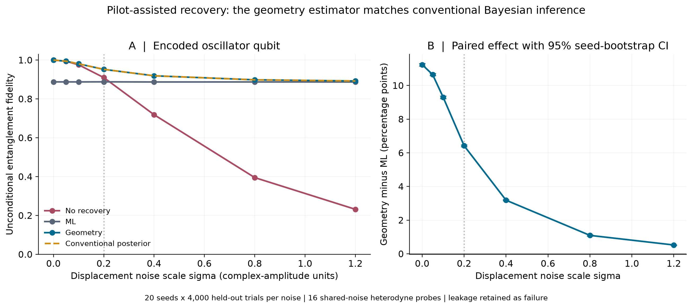
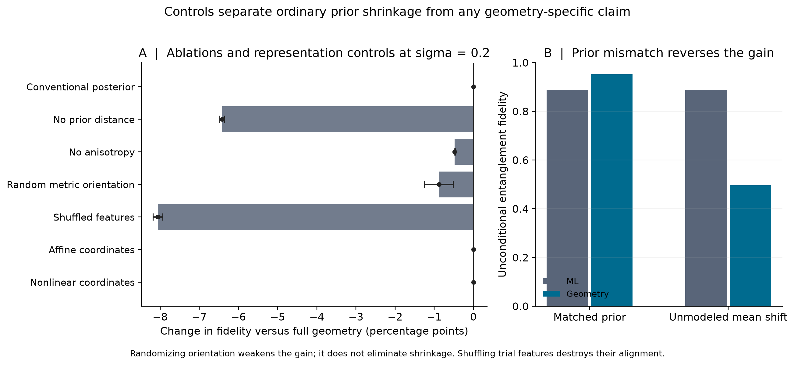
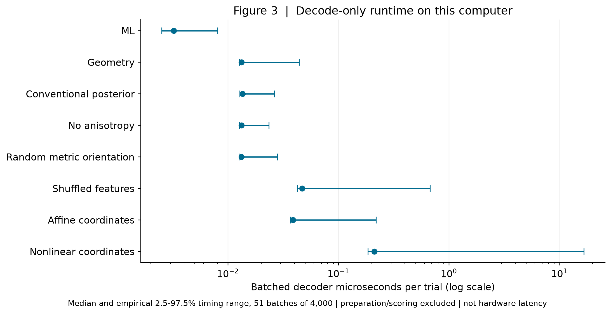

# Preliminary QIS Benchmark Report

## Pilot-assisted bosonic displacement recovery with geometry-informed features

Jason D. Dutton | Independent Researcher, Castlewood, Virginia, USA | October 6, 2026

Supporting computational evidence for an NSF Quantum Information Science proposal. One simulation study; no journal manuscript, experimental hardware result, protecting-code threshold, quantum advantage, or foundational-theory validation is claimed.

## Abstract

We tested whether calibrated phase-space distance features help recover an unknown qubit from a bosonic random-displacement channel. The qubit occupies the finite-energy Fock subspace spanned by |0> and |1>. Sixteen separate coherent probe modes undergo the same displacement and are heterodyne measured; correction estimates use only their common sufficient statistic. A maximum-likelihood estimator, a geometry-distance regularizer, and an independently implemented conventional Gaussian posterior receive identical observations and access to identical calibration data. Across seven noise conditions, twenty independent seeds, and 560,000 held-out trials, the primary noise condition gives entanglement fidelity {{PRIMARY_G}} for geometry versus {{PRIMARY_ML}} for ML. The paired gain is {{DELTA}} with 95% seed-bootstrap interval {{DELTA_CI}}. However, the geometry estimator equals the conventional Gaussian posterior to numerical precision. Affine coordinate controls preserve predictions; anisotropy ablation and orientation randomization weaken rather than eliminate improvement. Feature shuffling destroys alignment, while an unmodeled displacement mean shift reverses the gain. This is evidence of a reproducible conventional quantum-recovery workflow and a null result for a geometry-specific advantage in the tested estimator family.

## What has been demonstrated

The benchmark propagates quantum information through physical oscillator displacements and evaluates the overlap of an entangled input-reference state after recovery. It is more than a classical classification score. The classical calculation estimates a displacement; the quantum payload's coherence and leakage determine the primary metric. An explicit decoded qubit-to-erasure channel is completely positive and trace preserving. Exact oscillator formulas are checked against independent finite-Fock matrix exponentiation and explicit Bell-pair evolution.

The unknown payload is not measured to supply decoder information. The experiment uses auxiliary sensing, not a measured stabilizer syndrome. Its two-Fock-level encoding supplies an actual logical representation but no intrinsic protection against displacement. Throughout this report, encoded-qubit entanglement fidelity means retention of this representation, not fault-tolerant logical fidelity.

---PAGE---

## 1. Repository audit and implementation

The live SEFI-PY tree was pinned to commit 5b9ce48af8ed9f3a493bb6cf03c7227b194c02d6. Its nontruncated recursive tree contains 5,352 entries. All 256 owned Python/JavaScript/TypeScript/Q#/configuration source files in the filtered inventory were read (9,866 lines) and matched to pinned Git blobs with Windows line-ending normalization. Binary assets, dependency trees and the external gitlink were not independently scientifically validated. A full source inventory and static parsing record accompany this study.

Geometry, classical dynamics, observers/diagnostics, phase tracking, recurrence tools, visualizers and tests already exist in several overlapping subtrees. `core/time_dynamics.py` supplies classical recurrence and phase mathematics; it does not supply a quantum protection mechanism. The calibration workbench provides an observation/truth separation pattern that can be reused. No recurrence feature is warranted for this memoryless experiment.

`core/quantum.py` has duplicate class definitions and normalized Euler propagation over warp configurations. The QEC Stack includes classical bit-list decoding and placeholder phase noise; the geometric syndrome helper thresholds already supplied coordinates. These do not constitute validated bosonic state/channel/noise/syndrome/ML infrastructure. Five legacy QEC Stack Python files fail static parsing. The new benchmark does not import or repair them. These audit findings are documented rather than hidden.

The minimum addition is an isolated directory with oscillator reference calculations, measurement-only decoders, a fixed protocol, seeded simulation, controls/statistics, physical tests, figures and this report. No legacy public API or license changes are required. `TECHNICAL_AUDIT.md` provides path-level existing/missing-component tables and the complete implementation plan. This report certifies only the newly executed benchmark checks, not all historical repository claims.

## 2. Questions and operational hypothesis

Primary question: under calibrated shared displacement noise, can phase-space distance regularization increase unconditional encoded-qubit entanglement fidelity relative to probe-likelihood ML?

Attribution question: does any benefit exceed a conventional prior-matched Gaussian estimator? A gain over ML alone cannot establish a new geometric algorithm. Secondary questions concern metric anisotropy, coordinate changes, corrupted features, prior mismatch and CPU cost.

The representation is motivated by SEFI's use of reference geometry, distance and identity retention. The operational feature is a positive quadratic metric on measured oscillator phase space, defined using conventional noise statistics. It is not derived from a new physical law, and no SEFI, DEFI, GWFM or unified-field claim is tested.

---PAGE---

## 3. Quantum state, channel and measurement methodology

We use [a,a-dagger]=1, complex displacement beta=x+iy, and q=(a+a-dagger)/sqrt(2), p=(a-a-dagger)/(i sqrt(2)). Thus x and y are complex-amplitude coordinates, not quadratures in an unstated convention. The physical unitary is D(beta)=exp(beta a-dagger - beta* a).

Payload encoding: V|0_L>=|0>, V|1_L>=|1>, with V-dagger V=I. The maximally mixed logical input has mean photon number 0.5. For the primary channel-fidelity evaluation, use the reference-payload Bell state (|0_R,0>+|1_R,1>)/sqrt(2). The six Pauli eigenstates provide an independent exact average-state fidelity check. Finite-energy Fock states avoid ideal infinite-energy grids and Gram-matrix ambiguity. They are deliberately an unprotected baseline encoding.

Noise is a classical two-dimensional zero-mean Gaussian beta with covariance Sigma = U diag(sigma^2, (sigma/2)^2) U-transpose, where U is a rotation of 0.45 radians. Sigma is positive semidefinite. The channel is the Gaussian mixture of D(beta) rho D(beta)-dagger. Each trial has a fresh independent beta. There is no loss channel in this minimum experiment; loss remains future work.

Sixteen independent coherent probes |alpha=1> share that trial's beta with the payload. The common-displacement joint channel is a classical mixture of the tensor-product unitary D(beta) acting on the payload and every probe. Heterodyne outcome z has density exp(-|z-alpha-beta|^2)/pi [1]. Each real/imaginary component therefore has conditional variance 1/2. The sufficient statistic y=mean(z)-alpha obeys y=beta+epsilon, with epsilon covariance R=I/32. Sampling y directly is exactly equivalent to averaging sixteen independent defined outcomes. Quantum noise is not omitted or replaced by noiseless access to beta.

Resources are identical for all principal decoders: one payload mode, sixteen additional measured modes, and sixteen input probe photons per trial. The payload state is unknown to the decoder. Both estimators receive y and have access to independent calibration covariance. Known calibration injections (2,000 per seed and noise condition) are used to fit Sigma; they are not held-out trial truth. Calibration noise injection must be controlled or measured in a real implementation, an assumption requiring experimental validation.

Correction is D(-beta_hat(y)) on the payload. Up to an irrelevant phase, the recovered state is D(beta-beta_hat) applied to the input. Shared displacement across probes and payload is a physical resource assumption, not a free syndrome or a claim about all bosonic error processes.

---PAGE---

## 4. Decoder definitions and equal-information boundary

Decoder A, maximum likelihood: maximize p(y|beta) under the Gaussian heterodyne likelihood. Its exact maximizer is beta_hat_A=y. It needs no approximation, learned classifier, or weak nearest-neighbor baseline. Available prior calibration is not included in a likelihood-only objective. This choice is not Bayes-optimal under the distribution being tested.

Decoder B, geometry-informed distance: minimize J(z)=(y-z)-transpose R-inverse (y-z) + z-transpose Sigma_hat-inverse z. The first term is measurement distance; the second is calibrated distance to the zero-displacement reference. Its solution is beta_hat_B=Sigma_hat (Sigma_hat+R)-inverse y. The zero-covariance limit returns zero. This is also the Gaussian posterior mean and Gaussian MAP in the stated physical coordinates. It is not a novel algorithm or a theorem about the research framework.

Conventional posterior control: independently solve (Sigma_hat-inverse+R-inverse) beta_hat=R-inverse y using precision-form algebra. It receives exactly the same fitted covariance. Its equality to B is both analytic and empirically checked over every held-out trial. It is optimal for mean-square displacement error under the Gaussian prior, not claimed globally optimal for quantum entanglement fidelity.

No recovery returns beta_hat=0. The feature ablations remove the prior-distance term (recovering A) or replace Sigma_hat by trace(Sigma_hat) I/2. Randomized orientation keeps eigenvalues while independently rotating the metric per seed. Shuffling features permutes y across trials while retaining its marginal distribution; this intentionally corrupts the correction information.

Affine coordinate control transforms y and both covariance matrices with a fixed invertible shear/scale T, predicts in that chart and maps back. The nonlinear check encodes with arcsinh and returns by sinh before inference in physical coordinates. That second test preserves information by construction and is not a full intrinsic nonlinear manifold decoder test.

Decoder methods accept observed y only. They do not receive beta truth, payload amplitudes, a full density matrix, future measurements or a simulator-only label. Simulator truth is restricted to generating measurements and evaluating residuals. Equality of accessible information is distinguished from equality of statistical objective; the conventional posterior control resolves that distinction.

---PAGE---

## 5. Primary metric, leakage and statistics

For residual r=beta-beta_hat and u=|r|^2, the exact code overlap is M=V-dagger D(r)V=exp(-u/2) [[1,-r*],[r,1-u]]. Unconditional entanglement fidelity is Fe=|Tr(M)|^2/4=exp(-u)(1-u/2)^2 [2,3]. This is also the Bell-state target overlap of the recovered oscillator/reference state. It is the designated primary metric.

Code-space survival S=Tr(M-dagger M)/2=exp(-u)(1+u^2/2). Unconditional six-state average fidelity is F6=(S+2Fe)/3. Leakage probability is 1-S and counts as failure. We do not divide by survival or renormalize a projected state. A decoder to logical qubit plus orthogonal erasure flag is explicitly implemented with Kraus operators; its completeness, Choi positivity, trace and partial trace are tested.

Classical recovery accuracy means the proportion of residuals with |r|<=0.25. It is a supplemental tolerance score, not a measured logical error probability. Residual mean-square error, survival, state fidelity, entanglement fidelity and decode-only runtime are all reported. There is a valid encoded representation, but no redundant QEC code or threshold; "logical fidelity" here cannot imply one.

The protocol fixes sigma=0.2 as the primary condition, before the first run. Seven scales [0,0.05,0.1,0.2,0.4,0.8,1.2] each use twenty seeds and 4,000 held-out trials per seed: 560,000 trials total, plus 280,000 calibration injections. Each noise condition has its own independently fitted covariance. This tests calibrated matched conditions, not blind identification of an unknown noise regime.

Each interval bootstraps twenty independent seed clusters 10,000 times. Clusters include calibration variation as well as held-out Monte Carlo variation. Paired contrasts resample within-seed differences between methods. Secondary comparisons are exploratory and their intervals are not multiplicity-adjusted. Probe outcomes are noisy; quantum fidelity is scored analytically rather than inferred from simulated finite-shot tomography.

Independent 40-by-40 Gauss-Hermite integration cross-checks linear-decoder expected Fe. Matrix displacement checks use cutoffs 8,16,32,48 on 104 points of radius at most 3. Headline scores use exact infinite-oscillator overlaps for all residuals, so the finite-grid check does not discard Gaussian tails. Nineteen physical/inference unit tests pass. At cutoff 48 the maximum code-block error is {{CUTOFF_ERROR}}; Kraus completeness defect is {{KRAUS_ERROR}} and minimum Choi eigenvalue is {{CHOI_MIN}} (roundoff-scale negativity).

---PAGE---

## 6. Results: Table 1

Primary-condition measured results. Every entry below uses 80,000 paired held-out trials. All seven noise levels, ten methods and all metric intervals are supplied in `results/table_1_all_results.csv`; seed-level data, costs, runtime samples and stress values accompany it. Pointwise 95% intervals are seed-bootstrap intervals.

{{PRIMARY_TABLE}}

At sigma=0.2, geometry-minus-ML Fe is {{DELTA}}, 95% CI {{DELTA_CI}}, corresponding to {{RELATIVE_REDUCTION}} relative reduction of ML entanglement infidelity. It also exceeds no recovery; ML itself is worse than no recovery at this condition. The no-prior-distance ablation equals ML, while removing anisotropy preserves most of the gain. Randomizing orientation also preserves most of the gain; correct anisotropy contributes a smaller increment.

The conventional posterior and geometry estimator produce identical reported Fe; maximum estimate difference is {{EQUIVALENCE_ERROR}}. There is therefore no geometry-specific recovery gain over that ordinary comparator. Affine and nonlinear representation controls agree within the same numerical scale. Feature shuffling lowers recovery below ML, showing that trial alignment matters.

An unmodeled displacement mean shift of (0.75,-0.40), with the original prior retained, lowers geometry Fe to {{SHIFT_G}} while ML stays at {{PRIMARY_ML}}. The paired shift-condition effect versus ML is {{SHIFT_DELTA}}, CI {{SHIFT_CI}}. The conditional improvement cannot be claimed as robust to prior drift.

{{NOISE_TABLE}}

---PAGE---

## Figure 1. Noise level versus performance

Left: unconditional encoded-qubit entanglement fidelity. Shading shows pointwise 95% seed-bootstrap intervals. Geometry and the conventional posterior overlap; the dashed conventional line is deliberately displayed rather than suppressed. No recovery establishes whether correcting noisy observations is useful. Right: paired geometry-minus-ML effect in percentage points; vertical dotted line marks the fixed primary condition. This plot contains no ideal stabilizer, no infinite-energy GKP state and no hardware measurements.

## Figure 2. Ablation and negative comparison

Left: paired differences from full geometry at the primary condition, with pointwise 95% intervals. Prior removal eliminates the gain; removing or scrambling anisotropy preserves generic shrinkage. The conventional comparator and coordinate controls have zero effect. Right: a deliberately unmodeled mean shift reverses the prior-based benefit. These controls prevent attributing ordinary prior information or favorable calibration to an unestablished physical mechanism.

---PAGE---

## Figure 3. Runtime comparison

Decode-only CPU timings use fifty-one repeated batches of 4,000 observations, with randomized method order and a warm-up. Dots show medians; bars are empirical 2.5-97.5% timing ranges, not statistical confidence intervals. Runtime excludes calibration, payload/probe preparation, measurement, actuation and fidelity scoring. This is amortized vectorized throughput, not instrument latency. Full raw timing samples are retained.

ML takes approximately {{ML_RUNTIME}} microseconds per observation; geometry {{G_RUNTIME}}. The geometry/conventional operation is fixed two-dimensional matrix multiplication, O(N) in trial count with O(1) setup algebra and O(Ncal) calibration. The additional representational transformations add CPU work. There is no observed runtime advantage over ML and no quantum computational speedup claim. Absolute timings are environment-dependent and sensitive to allocation, scheduling and batch size.

## 7. Discussion

The simulation connects a reference-distance feature to a physically defined quantum channel and an entanglement metric. That is useful preliminary computational work: it separates observations from inaccessible truth, includes physical leakage, establishes repeatability, measures uncertainty and makes adverse findings visible.

The positive effect versus ML has a conventional explanation. ML corrects even a weak displacement using noisy probes; shrinkage trades bias against probe variance using calibration. Anisotropic covariance slightly improves that trade-off. Rewriting Gaussian posterior inference as a geometry-distance optimization does not create extra information. The strongest defensible conclusion is conditional prior-assisted recovery, with a null result for any unique geometric algorithmic advantage here.

The bias stress test is equally important: prior-based correction can be substantially worse than ML when the prior is wrong. Claiming broad robustness or general QEC performance would contradict the evidence. The benchmark is a transparent foundation for harder comparisons, not their replacement.

---PAGE---

## 8. Negative controls and limitations

Equal information is enforced at the decoder boundary. The prior-matched conventional baseline exactly matches geometry. Coordinate tests pass, with the nonlinear test's limited scope stated. Prior-distance ablation equals ML; isotropic and randomized-orientation metrics retain generic shrinkage. Shuffling features destroys per-trial information. No recovery outperforms ML in weak-noise regimes. A prior-mean mismatch reverses geometry's benefit. Details and numerical contrasts are in `NEGATIVE_CONTROLS.md` and the raw control tables.

The most important physical limitation is perfect common displacement across one payload and sixteen probes. Independent payload noise, finite probe/payload correlation time, imperfect heterodyne detectors, actuator noise and calibration drift are not modeled. Extra measured modes and their photon budget are real resources, disclosed and matched across decoders. These resources would not be freely available in every QEC architecture.

The encoding is span{|0>,|1>}, not a redundant bosonic error-correcting code. No stabilizer syndrome extraction, loss model, logical gate, repeated QEC cycle, ancilla fault model, quantum capacity or threshold is demonstrated. This benchmark addresses the proposal's measurement/feature/recovery workflow, not its full finite-energy GKP decoding objective.

The prior is Gaussian, stationary and freshly calibrated at each noise level. A plug-in covariance with assumed zero mean is adequate in-distribution but fails under the documented shift. Non-Gaussian and online-learned priors remain untested. The posterior mean is optimal for squared displacement error, not necessarily entanglement fidelity; there is no SDP optimum or quantum optimal-recovery upper bound in this minimum study.

Confidence intervals concern this synthetic channel model. Twenty seeds are adequate for a preliminary paired analysis but do not represent hardware uncertainty or arbitrary instrument populations. Secondary controls use unadjusted pointwise intervals. The primary endpoint was fixed in the local protocol, with no external preregistration. Exact final-fidelity scoring is a simulator capability; an experiment would require tomography and its uncertainty budget.

## 9. Future work and gates

First, test imperfect probe/payload displacement correlation, prior-mean adaptation, calibration uncertainty, detector noise and recovery-actuator error. Compare geometry only against equivalently calibrated Bayesian/adaptive baselines. Require predesignated held-out noise regimes and improvements beyond their uncertainty; retain null outcomes.

Then implement a finite-energy GKP [4] or other redundant bosonic code with a real syndrome instrument and CPTP recovery. Include analog ML, matched information, cutoff/energy convergence and logical entanglement fidelity. Small-instance optimal-recovery bounds should determine how far every candidate is from a meaningful ceiling. Only these later experiments can support claims about syndrome QEC or protecting logical encodings.

---PAGE---

## 10. Skeptical reviewer attack and revised conclusions

| Criticism or alternative explanation | Response and resulting claim limit |
|---|---|
| This is ordinary shrinkage, not a new decoder. | Correct. Independently coded conventional inference matches geometry. Remove novelty/unique-advantage language. |
| ML is an unfairly prior-free comparator. | Calibration is available to all, but likelihood-only ML ignores it. Include the matched posterior and no-recovery controls; infer no advantage over ordinary best-matched inference. |
| The probes supply a favorable side channel. | Correct; sixteen measured modes and common displacement are disclosed. Make pilot assistance explicit in the title; test imperfect correlation next. |
| It is not a protecting QEC code. | Correct; the first two Fock levels encode quantum information without redundancy. Claim encoded-state recovery only; future GKP study remains necessary. |
| The displayed fidelity could be postselected. | It is unconditional; leakage retained as erasure. Independently validate Bell-pair and six-state overlaps. |
| Calibration gets simulator truth. | Only independently controlled calibration injections are known. Held-out truth stays outside decoders. A real calibration protocol is still needed. |
| Geometry might just exploit coordinate units. | Transform covariances and corrections covariantly; affine predictions agree. Nonlinear round-trip is a narrower information check, not an intrinsic-chart proof. |
| Random geometry still works. | Report this explicitly; generic shrinkage explains most benefit. Trial-shuffling is destructive but does not establish novelty. |
| The result will fail under drift. | It does fail under the included bias shift. Remove broad robustness claims; add adaptation and correlation gates. |
| Timing numbers are unrealistically small. | They are amortized vectorized batch throughput, excluding physical costs. Preserve timing ranges and do not interpret as hardware latency. |
| Seed/noise selection or many controls could favor a claim. | Fixed primary endpoint and all seeds/noise scales retained; secondary effects exploratory. No familywise significance or externally preregistered claim. |
| Finite matrices may fake a physical channel. | Score exact oscillator overlaps; cross-check cutoffs and explicit CPTP erasure map. Grid limits are stated. |

Revised conclusion after this review: a fully specified, physically consistent pilot-assisted quantum-state recovery simulation has been executed with reproducible statistics and controls. Calibration-based phase-space regularization improves over likelihood-only estimation in matched conditions, but is exactly conventional Gaussian posterior inference and is vulnerable to prior mismatch. No geometry-specific algorithmic advantage, quantum computational advantage or foundational-theory validation is supported. This conclusion remains valid when the strongest contrary evidence is included.

---PAGE---

## 11. NSF relevance and recommended preliminary-work wording

This study supplies a concrete preliminary quantum-information simulation where earlier repository material largely supplied classical geometry and prototypes. Its defensible value is capability: a physical channel, observation-only recovery, entangled-state scoring, statistical contrasts, physical checks, reproducible code and documented failure cases. It supports feasibility of the proposal's computational evaluation infrastructure and sharpens risks. It does not establish the proposal's GKP-decoding result, novelty, eligibility or institutional support.

Recommended wording: "We implemented a pilot-assisted bosonic displacement-recovery simulation using an unknown qubit encoded in the first two Fock levels, independent coherent probes, and unconditional entanglement fidelity. In 560,000 held-out trials across seven noise conditions and twenty independently calibrated seeds, a reference-distance regularizer improved fidelity over probe-likelihood ML at a designated matched-noise condition (Fe 0.95212 versus 0.88792; paired difference 0.06419, 95% CI [0.06358,0.06476]). A prior-matched conventional Gaussian posterior produced identical estimates, and a prior-mean mismatch reversed the gain. These results demonstrate a reproducible quantum-recovery evaluation pipeline and identify ordinary prior information and calibration sensitivity as essential controls. They do not demonstrate a distinct geometric decoder advantage or protecting-code performance. The proposed work extends this infrastructure to genuine finite-energy bosonic syndrome recovery with stronger baselines and resource accounting."

Attach the report or one-page figure/summary only when permitted by the program or solicitation; do not assume unsolicited proposal supplements are allowed. Cite the exact code/data version once publicly archived or provided to the institution. A local package is not a public DOI or peer-reviewed result. Submitted SEFI works are not used as established physical premises.

## 12. Reproducibility and sources

`protocol.json` fixes the design; results/run_record.json records versions, environment, hashes, resources and checks. Raw trials, calibration covariances, seed metrics, every noise/method result, paired uncertainty, runtime samples, stress tests, independent Gaussian quadrature and cutoff data are included. README.md gives exact rebuild commands. REPRODUCIBILITY.md distinguishes fixed numerical results from hardware-dependent timing. TECHNICAL_AUDIT.md and IMPLEMENTATION_AND_PR.md supply the repository gap analysis, architecture and review-ready change description.

[1] C. Weedbrook, S. Pirandola, R. Garcia-Patron, N. J. Cerf, T. C. Ralph, J. H. Shapiro and S. Lloyd, Gaussian Quantum Information, Rev. Mod. Phys. 84, 621 (2012). https://doi.org/10.1103/RevModPhys.84.621 ; https://arxiv.org/abs/1110.3234 . Conventional Gaussian/heterodyne background.

[2] B. Schumacher, Sending quantum entanglement through noisy channels, Phys. Rev. A 54, 2614 (1996). https://arxiv.org/abs/quant-ph/9604023 . Entanglement-fidelity framework.

[3] M. A. Nielsen, The entanglement fidelity and quantum error correction (1996). https://arxiv.org/abs/quant-ph/9606012 . Operational relevance and formulas for entanglement fidelity.

[4] D. Gottesman, A. Kitaev and J. Preskill, Encoding a qubit in an oscillator, Phys. Rev. A 64, 012310 (2001). https://doi.org/10.1103/PhysRevA.64.012310 ; https://arxiv.org/abs/quant-ph/0008040 . Established oscillator-code context for future work; this benchmark does not implement that code.

[5] J. D. Dutton, SEFI-PY software, audited base commit 5b9ce48af8ed9f3a493bb6cf03c7227b194c02d6 (2026). https://github.com/JasonSEFIDEFI/SEFI-PY/tree/5b9ce48af8ed9f3a493bb6cf03c7227b194c02d6 . Benchmark additions accompanying this report are local until explicitly published and versioned.
