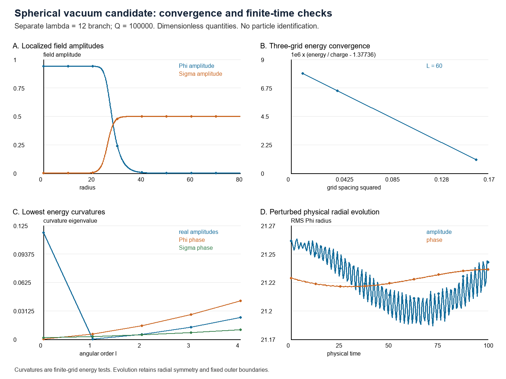

# A localized charged solution in the separate vacuum branch

Research checkpoint, 19 October 2026. These calculations examine the existing two-scalar potential family at lambda=12. They do not modify the production vortex equations at lambda=25, introduce an independent identity/Authorship field, or identify an observed particle. All quantities are dimensionless.

## Action, equations and conserved charge

Write rho=|Phi|^2, eta=|Sigma|^2, with two complex scalar fields on flat spacetime of signature (+---). The canonical real-component action reconstructed from the implemented potential family is

    S = integral d^4x [ (partial_mu Phi* partial^mu Phi
                          + partial_mu Sigma* partial^mu Sigma)/2 - V ],
    V = rho^2/4 + rho/2 + 2 rho eta + lambda(eta-3/lambda)^2/4.

V is the physical potential with its vacuum constant subtracted. V>=0, and its zero-charge vacuum is Phi=0, |Sigma|=sqrt(3/lambda). Independent global phase symmetries yield

    j_Phi^mu = Im(Phi* partial^mu Phi),
    j_Sigma^mu = Im(Sigma* partial^mu Sigma),
    partial_mu j_a^mu = 0,
    Q_a = integral d^3x j_a^0.

The Euler-Lagrange equations are

    Phi_tt - Laplacian Phi + (1+|Phi|^2+4|Sigma|^2)Phi = 0,
    Sigma_tt - Laplacian Sigma + (-3+4|Phi|^2+lambda|Sigma|^2)Sigma = 0.

The symmetric energy-momentum tensor is

    T_munu = Re(partial_mu Phi* partial_nu Phi
                 + partial_mu Sigma* partial_nu Sigma) - g_munu L.

Its T00 integrates to positive kinetic and spatial-gradient terms plus V. This action explains the particular numerical equations used here. It is not a derivation of these fields or coefficients from the author's broader identity axioms.

## Fixed-charge spherical reduction

Use Phi=exp(i omega t) f(r), Sigma=s(r), with real profiles, f'(0)=s'(0)=0, f(infinity)=0 and s(infinity)=sqrt(3/lambda). Define I=4 pi integral r^2 f^2 dr. Then Q_Phi=omega I and Q_Sigma=0. Eliminating omega at prescribed Q gives

    E_Q[f,s] = 4 pi integral r^2 [(f'^2+s'^2)/2+V(f,s)] dr + Q^2/(2I).

The profile equations are

    f''+2f'/r + (omega^2-1-f^2-4s^2)f = 0,
    s''+2s'/r + (3-4f^2-lambda s^2)s = 0.

The small-amplitude Phi threshold is m_Phi=sqrt(1+12/lambda). At lambda=12 this is sqrt(2). The energetically permitted frequency window has lower squared endpoint 1+3/sqrt(12). The computed omega, approximately 1.3735144, lies inside that window. Energetic permission alone was not used as an existence or stability proof: actual discrete profiles were solved.

## Convergence results

At Q=100000 and lambda=12, each search reached maximum discrete equation residual below 1e-7:

| Radius L | Grid h | Energy / charge |
|---|---|---|
| 60 | 0.4 | 1.377361075575 |
| 60 | 0.2 | 1.377366536422 |
| 60 | 0.1 | 1.377367898372 |
| 80 | 0.2 | 1.377366536418 |
| 80 | 0.1 | 1.377367898368 |

The three-grid energy differences decrease by approximately a factor of four, consistent with the spatial discretization's second-order behavior. Extending L from 60 to 80 gives negligible energy change at fixed h for this profile, although this is a finite set of domain checks. The result lies about 2.61% below the free-Phi charge threshold. This excludes decay solely into a dilute collection of free Phi excitations at the same charge and in this classical vacuum sector; it does not establish the global minimum against every competing charged configuration or fission channel.

## Second variation, including nonspherical directions

Let D_l = -d^2/dr^2 - 2/r d/dr + l(l+1)/r^2. With the usual radial volume inner product, the real-amplitude second variation has local block

    H_l = [[D_l+1+3f^2+4s^2-omega^2, 8fs],
           [8fs, D_l-3+4f^2+3lambda s^2]].

For l=0 only, fixed-charge elimination adds the positive rank-one operator (4 omega^2/I) |f><f| to its Phi block. For l>0 the first-order angular integral vanishes, so that term is absent. The independent imaginary-field blocks are

    P_l = D_l+1+f^2+4s^2-omega^2,
    S_l = D_l-3+4f^2+lambda s^2.

These operators were constructed from the same discrete energy and tested against directional derivatives, including both complex phase directions. Three lowest eigenpairs were calculated in every block for l=0,...,4 on four grid/domain combinations. No negative eigenvalue was found. The Phi global phase direction is close to zero; the l=1 real-amplitude eigenvalue approaches zero with refinement, consistent with translation symmetry. Finite boundaries and residual profile error lift exact symmetry zero modes. Higher l adds a positive centrifugal term to the l>=1 blocks; the computed spectra support local constrained energy stability, but floating-point eigenvalues are not a rigorous interval-certified continuum theorem.

The continuum dilation identity is K+3U-3C=0, where C=Q^2/(2I). Its relative residual falls from about 1.06e-5 at h=0.4 to 7.02e-7 at h=0.1 for L=60, another consistency check.

## Physical time evolution

The time integrator evolves the physical equations in Phi's rotating representation. It does not reuse relaxation iterations as time. Four separate runs reached T=100 on h=0.2, L=80: an unperturbed control, a 1% smooth amplitude perturbation, the same perturbation with half the time step, and a 1% smooth phase perturbation in both fields. Initial Phi velocities were adjusted to preserve Q_Phi=100000. Initial Sigma velocities were zero.

The localized profile persisted in these radial runs. Maximum relative energy drift was 6.86e-11 for the amplitude run at dt=0.02 and 2.14e-12 at dt=0.01. The phase run's energy drift was below 1.10e-14. Conservation precision measures numerical integration quality; it is not itself stability evidence. Radius and profile histories, final states and temporal differences are in SPHERICAL_CHECKPOINT.json and the individual raw records. Fixed outer boundaries can reflect radiation, and a phase-fixed Sigma boundary can exchange Sigma charge; that diagnostic is recorded. These runs do not simulate arbitrary three-dimensional nonlinear perturbations.

## Physical interpretation and provenance

This is evidence for a localized, below-free-threshold classical charged solution in a specified scalar theory, with grid/domain checks, nonnegative computed constrained curvatures, and finite-time radial persistence. The stationary spherical configuration has zero classical spatial angular momentum and no electromagnetic gauge field. Its global charge has not been identified with electric charge, its units have not been calibrated, and fermionic spin/statistics have not been derived. It is not evidence that electrons, nuclei or atoms have been derived from identity science.

Charged localized scalar configurations are an established research subject. Relevant comparisons include Olivier Lennon, [Multi-Field Q-balls with Real Scalars](https://arxiv.org/abs/2112.14263), and Mai and Schweitzer, [Energy momentum tensor, stability, and the D-term of Q-balls](https://arxiv.org/abs/1206.2632). Those works provide context, not numerical validation of this particular two-complex-field branch or an identity-theory novelty claim.

Reproduction: vacuum_spherical.py with explicit new run names and the grid/domain choices above; spherical_stability.py; spherical_evolution.py; spherical_checkpoint.py. Existing finished run names are protected against overwrite. The first development invocation of the curvature checker failed because its test vector was accidentally mutated through an array view; copying the vector corrected the checker before any spectrum was accepted. No failed validation output is included as a physical spectrum. Completed and interrupted scientific runs remain separately classified.
