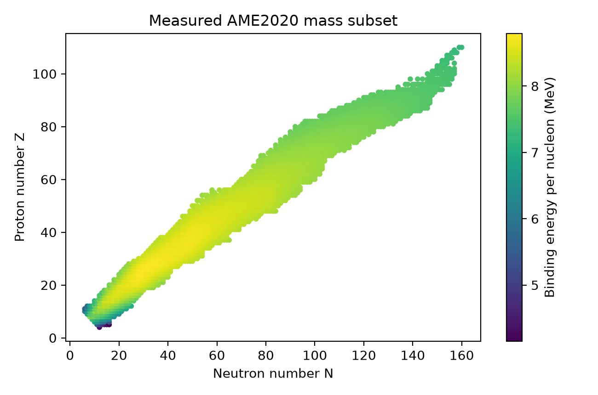
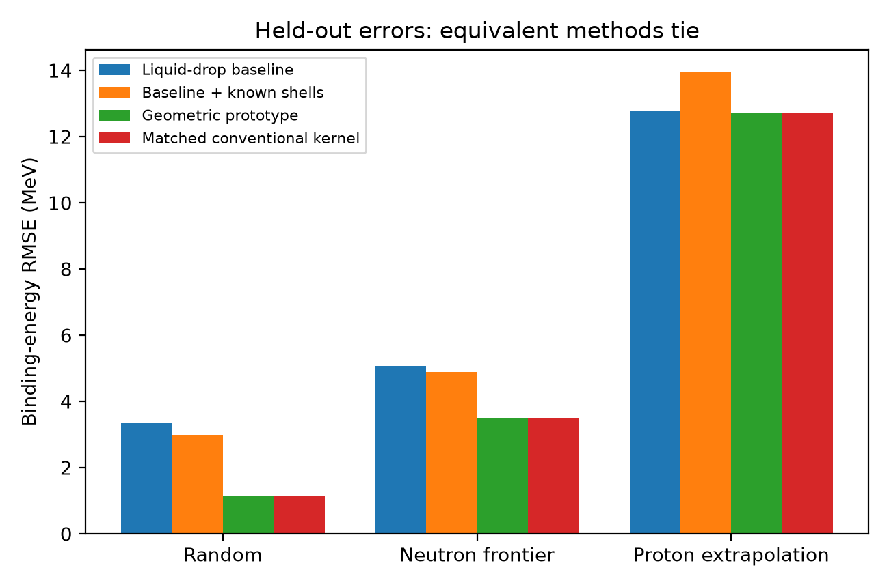

# SEFI:ELEMENTS
## A Falsifiable Geometric Reconstruction of the Isotope Chart: Nuclear Mass Prediction, Stability Tests, and Limits on Missing-State Inference

**Jason D. Dutton**  
Working manuscript — October 23, 2026  
Status: exploratory computational study; not submitted; no new-element discovery claim.

### Abstract

We formulate a testable reconstruction of a proposed Single Entity Field Interpretation (SEFI) mapping of matter into geometric identity coordinates. Because the original periodic assignment was not retained, the reconstruction is explicitly a new statistical proposal rather than a recovered physical law. We join 3,558 AME2020 ground-state mass entries to NUBASE2020 and evaluate 2,484 non-extrapolated mass entries with mass number at least 16. A conventional semi-empirical mass formula is compared with known-shell features and a geometric residual estimator under ten random splits, proton-number extrapolation, a neutron-rich frontier holdout, and a discovery-year proxy. The geometric estimator is also implemented as a matched conventional kernel model. Mean random-split total binding-energy RMSE decreases from 3.3411 MeV for the simple mass formula to 1.1427 MeV for either equivalent residual model. An additional AME2016-to-AME2020 assessment of 73 newly non-extrapolated masses reduces average error from 5.2304 to 3.0045 MeV, again tying the matched conventional model. Proton extrapolation gives 12.7116 MeV RMSE and only 6.6% empirical coverage for nominal 90% residual-calibrated intervals. A proposed exponential lifetime-distance law performs poorly against basic references, particularly outside the fitted region. We prove that an empty embedding location is insufficient to infer nuclear realization and that the implemented geometric estimator is mathematically conventional kernel regression. The results establish a reproducible assessment framework and a conditional improvement over a simple baseline; they do not establish a SEFI-specific advantage, a new interaction, or a realizable undiscovered element.

**Keywords:** nuclear masses; isotope chart; geometric representation; extrapolation; uncertainty; SEFI; falsifiability.

### 1. Question and scope

The motivating question is whether a geometric description associated with SEFI can identify nuclear states not already represented by known measurements. This question must be separated into three claims: descriptive organization, predictive advantage, and physical realization. Each requires additional evidence beyond the preceding claim.

The unit of analysis is a ground-state nuclide indexed by integer proton and neutron counts $(Z,N)$, not one representative point per element. Element identity fixes $Z$ but does not fix isotope-dependent mass or decay properties. Chemical groups and valence structure require electronic physics and are outside this nuclear prototype. The IUPAC table provides the element-level context, not a substitute for an isotope dataset. [IUPAC](https://iupac.org/what-we-do/periodic-table-of-elements/)

Evaluated masses, decay properties, conventional shell-based formulas, Bayesian residual models, and recent learned representations already supply a substantial research background. Our simple liquid-drop reference is deliberately transparent, not state of the art. A focused literature review accompanies this manuscript. [AME2020](https://doi.org/10.1088/1674-1137/abddaf), [NUBASE2020](https://doi.org/10.1088/1674-1137/abddae), [Duflo–Zuker](https://arxiv.org/abs/nucl-th/9505011), [Neufcourt et al.](https://arxiv.org/abs/1806.00552)

The existence of structured learned nuclear representations is not itself new. Recent work explicitly studies interpretable proton and neutron embeddings. Our reconstruction must therefore be assessed by its additional predictions and guarantees, rather than by the appearance of a geometric visualization. We do not benchmark that recent model here. [Richardson et al.](https://www.nature.com/articles/s44488-026-00017-9)

### 2. Mathematical reconstruction

#### 2.1 Observable inputs and dimensionless coordinates

Let $\mathcal{D}\subset\mathbb{Z}_{>0}^2$ be a set of measured ground-state nuclides and let $A=Z+N$. Define the input chart

$$\psi_0(Z,N)=(Z,N).$$

Its Euclidean distance is measured in nucleon-count units. A dimensionless, physically annotated descriptive extension may be written

$$\psi_7(Z,N)=\left(\frac{Z}{Z_0},\frac{N-Z}{A},A^{-1/3},(-1)^Z,(-1)^N,\frac{d_Z}{m_0},\frac{d_N}{m_0}\right),$$

where $Z_0,m_0>0$ are declared scale constants and $d_Z,d_N$ are distances to separately specified proton and neutron shell closures. This seven-coordinate extension is a proposed annotation, not the feature vector used by the tested two-coordinate kernel. It is not uniquely determined by SEFI terminology. The benchmark instead tests $\psi_0$ and a separate conventional shell-feature control.

The proton closures supplied to that control are $2,8,20,28,50,82$; neutron closures additionally include $126$. They are prior information, not predictions. No superheavy closure is inserted and then claimed to emerge. The two shell distances remain separate; their minimum alone would erase the distinction between proton and neutron structure.

Neither measured binding energy nor lifetime appears in the prediction coordinates. They are targets. A descriptive plot may color points by measured binding energy, but such coloring is not a predictor of an unmeasured target. Lifetime transforms use $\log_{10}(t_{1/2}/(1\,\mathrm{s}))$; logarithms of dimensional quantities without a reference scale are avoided. Mean lifetime and half-life differ by $t_{1/2}=\tau\ln 2$.

#### 2.2 Conventional reference and geometric residual model

The total binding-energy baseline is

$$\widehat B_0=a_v A-a_s A^{2/3}-a_c\frac{Z(Z-1)}{A^{1/3}}-a_a\frac{(N-Z)^2}{A}+a_p\frac{((-1)^Z+(-1)^N)/2}{\sqrt A}.$$

All five coefficients are fitted by least squares on the training subset only. A separate eight-coefficient control appends Gaussian features of supplied shell distances and their product.

For training residuals $r_i=B_i-\widehat B_0(x_i)$, the reconstructed geometric correction is

$$\widehat r_h(x)=\frac{\sum_i \exp[-\|x-x_i\|^2/(2h^2)]r_i}{1+\sum_i\exp[-\|x-x_i\|^2/(2h^2)]},\qquad \widehat B(x)=\widehat B_0(x)+\widehat r_h(x).$$

The extra denominator weight is a zero-residual prior contribution. It makes the correction approach zero far from the training data. Bandwidth is chosen from $h\in\{1.5,3,6\}$ using tuning data only.

**Proposition 1 - equivalence.** With $x=(Z,N)$ and the stated Euclidean metric, this estimator is regularized Gaussian kernel residual regression. Calling its distance geometric does not change its predictions. An implementation using pairwise distances and a separately computed broadcast-distance implementation agree to floating-point precision in the present runs. Consequently these implementations cannot demonstrate a mechanism-specific advantage over one another.

#### 2.3 Testable stability-distance hypothesis

For training nuclides labeled as having no observed decay, let $\mathcal{S}_{\mathrm{train}}$ contain their $(Z,N)$ locations. The operational distance is

$$d(x,\mathcal{S}_{\mathrm{train}})=\min_{s\in\mathcal{S}_{\mathrm{train}}}\|x-s\|.$$

We test the simple proposal $t_{1/2}=t_0e^{-k d}$ by fitting $\log_{10}(t_{1/2}/(1\,\mathrm{s}))=a-bd$ with $b\geq0$ to finite training lifetimes. This distance uses no test lifetime. It is a nearest-anchor hypothesis, not a derived nuclear decay law or a proved smooth stability manifold. Competing decay channels, quantum selection rules, and barrier penetration are not represented by this one-dimensional distance.

#### 2.4 Why holes do not establish existence

**Proposition 2 - non-identifiability from embedding.** A finite observed set does not determine physical occupancy outside that set. For an unobserved location, both an occupancy rule that assigns it a nuclear state and one that excludes it can agree on every observed point. Without an additional dynamical or spectral law, the embedding data do not select between these rules. Thus membership in a fitted surface, finite distance, or an unoccupied lattice position is not sufficient evidence of nuclear existence.

**Proposition 3 - density is not intrinsic curvature.** For an isotropic $d$-dimensional Gaussian density of bandwidth $h$, its Laplacian at the peak is $\Delta\rho(0)=-d\rho(0)/h^2<0$. This is a direct counterexample to the proposed rule that positive density Laplacian identifies clustering at a peak. More generally, a density Laplacian depends on the chosen measure and metric; it is not automatically the intrinsic curvature of a physical manifold. Neither sign establishes a stable nuclear state.

A hypothetical nuclide additionally needs integer quantum numbers and a justified description of a localized bound state or resonance, its relevant decay channels and barriers, and uncertainty. Energetic allowance for a decay does not exclude a metastable resonance; conversely a favorable fitted mass does not establish an observable lifetime. Formation and decay require physical models beyond the present map. [Ackermann](https://arxiv.org/abs/2501.04053), [Simenel et al.](https://arxiv.org/abs/2609.25621)

### 3. Data and protocol

The versioned AME2020 and NUBASE2020 text tables were downloaded from IAEA on October 23, 2026; exact URLs, byte counts, and SHA-256 hashes are recorded. We parse their fixed-width specifications, join by $(Z,N)$, select the NUBASE ground-state identifier, and retain all estimation and lifetime-status flags. All 3,558 mass entries join to a ground-state property record. The full snapshot includes 1,008 estimated mass rows; these are excluded from mass scoring. Restricting to $Z,N>0$, $A\geq16$, and non-extrapolated masses leaves 2,484 entries.

The full joined table has 2,832 finite evaluated half-lives and 253 no-observed-decay labels, alongside bounded, estimated, missing, and particle-unstable statuses. These are snapshot categories, not a statement of the current number of stable isotopes. Lifetime regression uses only finite, non-estimated numerical values within the mass-analysis subset. We do not convert stable labels to infinity, impute a numerical censoring bound, or use unavailable test lifetimes as features. A formal survival analysis remains future work.

Four protocols are executed:

1. Ten fixed random 60/20/20 training/validation/test splits, seeds 4200–4209.
2. Proton extrapolation: training $Z\leq70$, validation $71\leq Z\leq82$, testing $Z>82$.
3. Neutron frontier: within each sufficiently sampled element, the two largest measured neutron counts are test points and the next two validation points.
4. Discovery-year proxy: discovery years through 2000 for training, 2001–2010 for validation, and 2011–2020 for testing. This is not a historical mass-forecast benchmark: all numerical masses are from AME2020, and discovery time differs from mass-measurement time.

For mass models, the validation subset is divided into disjoint tuning and residual-calibration portions. A nominal 90% interval uses the finite-sample absolute-residual order statistic on the latter. Its empirical test coverage is reported. Distribution shift and nuclear-chart correlations prevent a blanket exchangeability guarantee. Bootstrap error comparisons resample entire proton-number clusters; they measure finite-test-set variation, not a complete theory uncertainty. AME covariance, evaluation-systematic uncertainty, and nuclear-model discrepancy are not fully propagated.

The analysis is exploratory and the original map was unavailable; these are not independently preregistered confirmatory tests. Every split and target prediction is saved. No newly invented element label or selected geometric gap is used as a positive outcome.

### 4. Results

#### 4.1 Nuclear masses

Across the ten random splits, mean RMSE is 3.3411 MeV for SEMF, 2.9059 MeV with supplied shell features, and 1.1427 MeV for either matched kernel formulation. These averages describe repeated, overlapping partitions of one evaluated dataset, not ten independent datasets.

| Split | Method | Test nuclei | Binding-energy RMSE (MeV) | Empirical nominal-90% coverage |
|---|---|---:|---:|---:|
| random_4200 | SEMF | 497 | 3.3323 | 88.1% |
| random_4200 | SEMF_known_shell_features | 497 | 2.9741 | 87.3% |
| random_4200 | SEFI_geometric_prototype | 497 | 1.1385 | 89.1% |
| random_4200 | conventional_matched_kernel | 497 | 1.1385 | 89.1% |
| proton_extrapolation | SEMF | 470 | 12.7649 | 14.5% |
| proton_extrapolation | SEMF_known_shell_features | 470 | 13.9305 | 23.6% |
| proton_extrapolation | SEFI_geometric_prototype | 470 | 12.7116 | 6.6% |
| proton_extrapolation | conventional_matched_kernel | 470 | 12.7116 | 6.6% |
| neutron_frontier | SEMF | 186 | 5.0808 | 79.6% |
| neutron_frontier | SEMF_known_shell_features | 186 | 4.8869 | 73.7% |
| neutron_frontier | SEFI_geometric_prototype | 186 | 3.4806 | 60.2% |
| neutron_frontier | conventional_matched_kernel | 186 | 3.4806 | 60.2% |
| discovery_year_proxy | SEMF | 28 | 9.2736 | 75.0% |
| discovery_year_proxy | SEMF_known_shell_features | 28 | 9.9950 | 75.0% |
| discovery_year_proxy | SEFI_geometric_prototype | 28 | 5.7544 | 71.4% |
| discovery_year_proxy | conventional_matched_kernel | 28 | 5.7544 | 71.4% |

For the representative first random split, the geometric model's RMSE difference from SEMF is -2.1938 MeV, with proton-cluster bootstrap 95% interval [-2.4844, -1.9252] MeV. This supports improved interpolation relative to a simple formula under this protocol. The conventional matched kernel gives the same improvement.

Extrapolation exposes the limitation. The prototype's 12.7116 MeV heavy-region error is accompanied by only 6.6% coverage from its residual-calibrated intervals. Neutron-frontier coverage is 60.2%. Thus narrower validation residuals did not supply trustworthy extrapolation uncertainties. These results do not support using this model to label an unmeasured superheavy nucleus long-lived or realizable. Adding known-shell features alone also fails to solve proton extrapolation.

#### 4.2 Earlier-evaluation test: AME2016 to AME2020

To replace the discovery-year proxy with a stronger chronological assessment, we additionally parse AME2016 and fit exclusively to its numerical binding energies. The eligible older pool contains 2,433 non-extrapolated masses with the same count and mass-number restrictions. The test cohort contains 73 entries non-extrapolated in AME2020 but absent or mass-estimated in AME2016. These nuclides are excluded from every fitting and tuning subset. This is an evaluation-status transition, not a claim that all were entirely new nuclides or direct independent mass measurements. [AME2016 source table and publication identifiers](https://www-nds.iaea.org/amdc/ame2016/mass16.txt)

Ten fixed seeds split the older pool 80/10/10 into coefficient fitting, bandwidth tuning, and residual calibration. The test set remains the same 73 later evaluated nuclei, so the averages quantify sensitivity to older-data fitting partitions rather than ten independent future datasets. Updated AME2020 values for older fitting nuclides are never substituted into the training targets.

| Method | Later test nuclei | Mean binding-energy RMSE (MeV) | Mean nominal-90% coverage |
|---|---:|---:|---:|
| SEMF | 73 | 5.2304 | 88.4% |
| SEMF_known_shell_features | 73 | 5.6641 | 82.5% |
| SEFI_geometric_prototype | 73 | 3.0045 | 77.9% |
| conventional_matched_kernel | 73 | 3.0045 | 77.9% |

The residual model improves over the simple baseline in this stronger test, but remains identical to its conventional counterpart and undercovers the later cohort. This is retrospective validation of a frozen implementation using separated evaluation targets, not a prospective prediction of a new element. The model family was developed with knowledge that AME2020 exists; independent prospective confirmation remains necessary. All 40 historical method/seed records, later-cohort predictions, and proton-cluster bootstrap comparisons are saved.

#### 4.3 Lifetime-distance hypothesis

The table reports errors in decimal logarithms of seconds; an error of one corresponds to one order of magnitude in half-life.

| Split | Method | Test radioactive nuclei | MAE in log10 seconds |
|---|---|---:|---:|
| random_4200 | training_median | 440 | 2.4257 |
| random_4200 | distance_stability_hypothesis | 440 | 2.4829 |
| random_4200 | conventional_polynomial | 440 | 1.9721 |
| random_4200 | conventional_kernel | 440 | 1.2655 |
| proton_extrapolation | training_median | 465 | 3.2629 |
| proton_extrapolation | distance_stability_hypothesis | 465 | 38.2976 |
| proton_extrapolation | conventional_polynomial | 465 | 4.9201 |
| proton_extrapolation | conventional_kernel | 465 | 3.2653 |
| neutron_frontier | training_median | 182 | 2.5027 |
| neutron_frontier | distance_stability_hypothesis | 182 | 2.9690 |
| neutron_frontier | conventional_polynomial | 182 | 2.1151 |
| neutron_frontier | conventional_kernel | 182 | 2.5110 |

The simple exponential distance law does not improve on the training-median reference in these displayed settings. In proton extrapolation it incurs approximately 38.3 orders of magnitude mean absolute error. This rejects the usefulness of this specific nearest-stable-anchor implementation for the intended extrapolation task. It does not reject every possible metric or establish a conclusion about all SEFI formulations. Revising the metric after observing this failure would require new held-out evaluation.

#### 4.4 Visualization and reproducibility

Figure 1. Measured inputs colored by an observed target; this is a descriptive isotope chart.

Figure 2. Held-out prediction errors. Equal performance of the geometric and conventional estimators reflects exact algorithmic equivalence rather than an independent physical confirmation.

Five parser, unit, split, kernel-equivalence, and sign checks pass. Data, split memberships, prediction tables, uncertainty summaries, environment versions, and source hashes are included. Local timings describe implementation cost on one machine, not an advantage in physical resources. The prototype requires NumPy and SciPy, with Matplotlib for figures.

### 5. What would establish an advantage or a new nuclear candidate?

The present results identify a narrower success than the motivating claim: ordinary residual geometry improves a simple mass baseline on known-nucleus interpolation. They do not establish superiority over modern microscopic, macroscopic–microscopic, or machine-learned nuclear models. Published models use additional structure and more demanding evaluation designs; quoted accuracies from other datasets cannot be compared directly to ours. [Yüksel et al.](https://arxiv.org/abs/2401.02824), [Huang et al.](https://arxiv.org/abs/2501.01352)

A mechanism-specific SEFI advantage requires an independently specified equation or constraint that changes predictions relative to the strongest information-matched conventional model. The next meaningful test is to freeze that equation and its metric, train on a genuinely earlier mass evaluation, and evaluate later new measurements, including calibration coverage. A second analysis should leave whole isotopic or isotonic regions untouched and compare equally tuned Gaussian-process, graph, and established physical mass models.

A new-nuclide candidate would require a distinct prediction $(Z,N)$ with numerical observables and uncertainties, plus physical assessment of its bound or resonant state and decay properties. Novel-element status additionally requires a new proton number; a new isotope of an existing element is a different claim. No such existence inference is made by this work, and no list of supposedly realizable empty embedding locations is produced.

To connect an underlying SEFI field equation to nuclear matter, a future manuscript must define its degrees of freedom, conserved charges, quantization or effective nuclear-state construction, and the mapping to proton/neutron number. It must derive a Hamiltonian or effective energy functional with a justified parameter determination and show how observable nuclear masses and decay behavior follow. Merely renaming empirical coordinates as field layers supplies none of these steps. Chemical periodicity and planetary dynamics would each require additional domain-specific derivations.

### 6. Conclusion

This reconstruction converts an intuitive periodic-map proposal into a reproducible isotope prediction problem. Its measured success is a reduction in interpolation error relative to a basic liquid-drop reference. Its limitations are equally definite: the matched conventional estimator is identical, heavy-region uncertainty coverage fails, and the tested exponential lifetime-distance law extrapolates poorly. The geometry alone supplies no missing-state existence criterion. SEFI:ELEMENTS is therefore presently a falsifiable research program with a completed exploratory assessment, not a demonstrated theory of undiscovered elements.

### References

1. W. J. Huang et al. The AME2020 atomic mass evaluation (I). *Chinese Physics C* **45**, 030002 (2021). [DOI](https://doi.org/10.1088/1674-1137/abddb0).
2. M. Wang et al. The AME2020 atomic mass evaluation (II). *Chinese Physics C* **45**, 030003 (2021). [DOI](https://doi.org/10.1088/1674-1137/abddaf).
3. F. G. Kondev et al. The NUBASE2020 evaluation of nuclear physics properties. *Chinese Physics C* **45**, 030001 (2021). [DOI](https://doi.org/10.1088/1674-1137/abddae).
4. J. Duflo and A. P. Zuker. Microscopic mass formulas. *Physical Review C* **52**, R23–R27 (1995). [Paper](https://arxiv.org/abs/nucl-th/9505011).
5. L. Neufcourt et al. Bayesian approach to model-based extrapolation of nuclear observables. *Physical Review C* **98**, 034318 (2018). [Paper](https://arxiv.org/abs/1806.00552).
6. E. Yüksel, D. Soydaner, and H. Bahtiyar. Nuclear mass predictions using machine learning models. *Physical Review C* **109**, 064322 (2024). [Paper](https://arxiv.org/abs/2401.02824).
7. Y. Huang et al. Validation and extrapolation of atomic mass with physics-informed fully connected neural network (2025 preprint). [Paper](https://arxiv.org/abs/2501.01352).
8. K. A. Richardson, S. Trifinopoulos, and M. Williams. Interpretable AI reveals hidden structure in nuclear masses. *Communications AI & Computing* **1**, 20 (2026). [Paper](https://www.nature.com/articles/s44488-026-00017-9).
9. D. Ackermann. Decay spectroscopy of heavy and superheavy nuclei (2025 review). [Paper](https://arxiv.org/abs/2501.04053).
10. C. Simenel, L. Guo, and K. Sekizawa. The Quest for Superheavy Nuclei: A Theoretical Perspective. *Annual Review of Nuclear and Particle Science* **76**, 219 (2026). [Paper](https://arxiv.org/abs/2609.25621).
11. M. Wang et al. The AME2016 atomic mass evaluation (II). *Chinese Physics C* **41**, 030003 (2017). [Official electronic table and publication identifiers](https://www-nds.iaea.org/amdc/ame2016/mass16.txt).

### Data and code availability

This working package is local pending author review. Data originate from the cited public evaluations; their provenance is recorded separately. Run `download_data.py`, `analyze.py`, `historical.py`, `uncertainty.py`, `plot_paper.py`, and `build_paper.py`, then the included tests, using the captured package versions. Optional PDF rendering uses ReportLab, Matplotlib, Pillow, and Windows Times New Roman fonts. The source Copilot discussion is treated as an unverified proposal, not scientific evidence. All numerical claims above are computed from saved completed runs; no experimental observation or new-element discovery is asserted.
