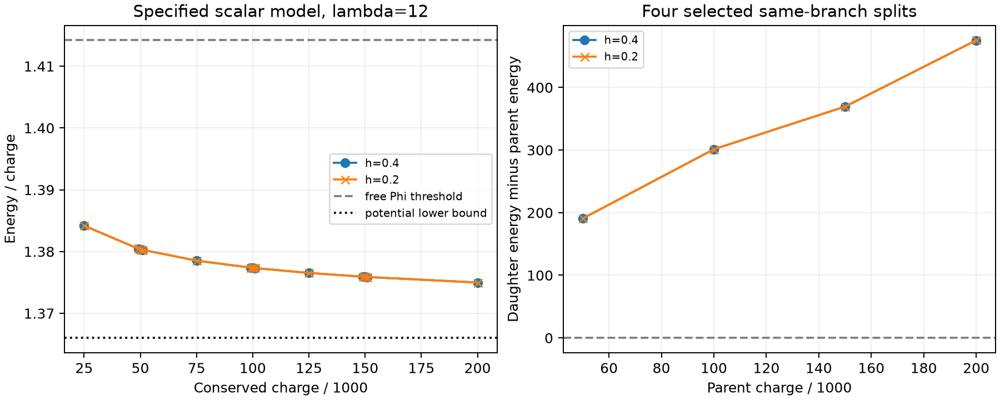

# Field-to-matter audit: action, charge branch and radial dynamics

Jason Duran Dutton — 23 October 2026

**Result:** the specified lambda=12 classical scalar model passes additional
branch-consistency and selected splitting tests. Two finite-grid radial
dynamical spectra contain no numerically resolved growing mode. This advances
the evidence for that charged localized branch. It does not identify physical
matter, derive the action from SEFI principles, or establish full nonlinear
stability. The existing lambda=25 vacuum binding obstruction remains intact.

This work starts from SEFI-PY commit
`847a071351ed2b1c54e240fd9a520a1cce238178`. Existing models, source, results
and history are preserved. The original derivations in
`research/2026-10-19/vortex-extended/PHYSICAL_BACKGROUND.md` and
`SPHERICAL_DERIVATION.md` already contain the potential inequality and the
lambda=12 candidate; they are independently rechecked here, not presented as
new discoveries.

## What is assumed and what follows

With two complex scalar fields, flat metric (+---), canonical kinetic terms
and rho=|Phi|^2, eta=|Sigma|^2, the assumed action density is

    L = (|partial Phi|^2 + |partial Sigma|^2)/2 - U,
    U = rho^2/4 + rho/2 + 2 rho eta + lambda(eta-3/lambda)^2/4.

The field content, coefficients, canonical kinetic structure and coupling
choice are inputs. They have not been derived from identity/Authorship
axioms. All quantities are dimensionless. The additive constant sets the
true-vacuum energy to zero; it does not change the field equations.

The Euler-Lagrange equations, both global phase currents and the stress tensor
then follow by variation. The vacuum is Phi=0 and |Sigma|=sqrt(3/lambda).
An independent real-component Hessian check gives, at lambda=12,

    mass squared: Phi_real=2, Phi_imag=2,
                  Sigma_radial=6, Sigma_phase=0.

The massless Sigma phase is the broken-global-U(1) direction. Finite-box phase
curvatures do not establish a mass gap in infinite space. A Phi mass scale is
already present in the assumed action; localization and the composite energy
can emerge from its nonlinear equations, but this is not a derivation of all
mass scales from a massless starting theory. The global charge is not electric
charge. No gauge coupling or fermionic spin/statistics has been derived.

## Exact restriction on the coupling family

For m_Phi^2=1+12/lambda, direct expansion gives

    U - m_Phi^2 rho/2
      = lambda/4 (eta-3/lambda+4rho/lambda)^2
        + (1/4-4/lambda) rho^2.

`audit.exact_square_identity` checks these polynomial coefficients using exact
rational arithmetic. For lambda>=16 the right side is nonnegative. Including
the positive kinetic and gradient terms and applying the charge inequality
gives E >= m_Phi |Q_Phi| for finite-energy configurations over this vacuum.
Thus lambda=25 cannot supply the proposed below-free-Phi-threshold globally
bound state in this sector. This does not exclude medium-supported rings or
all metastable structures, and is not a calculation at a prescribed nonzero
second charge.

Minimizing 2U/rho over eta>=0 first gives eta=max((3-4rho)/lambda,0). Its
infimum over rho>0 is

    mu_*^2 = 1+3/sqrt(lambda), lambda<16,
             1+12/lambda,     lambda>=16.

At lambda=16 the infimum is attained throughout 0<rho<=3/4 along
eta=(3-4rho)/16; for lambda>16 it is approached as rho tends to zero.
This clarifies the equality case beyond the earlier note's wording. A
subthreshold potential well is present for lambda<16; it is permission for
binding, not an existence/stability theorem. At lambda=12 the bounds are
mu_* approximately 1.3660254 and m_Phi=sqrt(2). Numerical one-dimensional
minimization independently agrees with the analytic infima at five couplings.

## Why holding charge fixed is physically justified

For Phi=exp(i omega t) f(r), Sigma=s(r), define I=integral f^2 d^3x.
The exact Noether charge is Q=omega I. Minimizing the kinetic energy of the
Phi time derivative at prescribed Q gives Q^2/(2I), hence

    E_Q = K + U_integrated + Q^2/(2I).

This is a conservation-law constraint, not an external force that holds the
object together. Stability should be tested within dynamically allowed charge
sectors; changing Q compares different initial conditions. Nevertheless,
checking only a restricted shape family would be insufficient. The numerical
search allows arbitrary radial profiles but retains spherical symmetry.

The localized interpolated initial guess is a solver seed, not a proof of
existence, uniqueness or formation. An exactly zero-energy, zero-charge vacuum
cannot evolve into a lone nonzero-charge positive-energy object under these
closed conservative equations. Formation would require appropriate initial
energy/charge, opposite-charge production with supplied energy, or a specified
environment. None of those formation scenarios is simulated here.

## New computations: energy versus charge

Twenty-six profiles were freshly relaxed: 13 charges from 25,000 to 200,000,
on h=0.4 and 0.2, L=80, lambda=12. Initial guesses rescale the preserved fine
profile; equations are solved again at each charge. All raw profiles and
records are retained in `results/`.

* All 26 final equation residuals were below 1.804e-8.
* Four reached the requested 1e-9 residual target; the other 22 stalled at
  floating-point line-search resolution. They are **not** marked as having
  met that target. All passed the separately declared 1e-7 usability gate.
* At Q=50,000, 100,000 and 150,000, centered differences with delta Q=1000
  agree with dE/dQ=omega to relative error <=2.101e-7 on both grids. These are
  finite-difference consistency checks, not error-certified identities.
* domega/dQ is negative at those three sampled points on both grids. This
  diagnostic alone does not prove stability in a multi-field theory.

Selected splitting results at h=0.2:

| Parent Q | Daughter charges | E(daughters)-E(parent) |
| --- | --- | --- |
| 50,000 | 25,000 + 25,000 | +190.762033 |
| 100,000 | 50,000 + 50,000 | +301.366335 |
| 150,000 | 50,000 + 100,000 | +369.488843 |
| 200,000 | 100,000 + 100,000 | +475.501639 |

The positive sign persists on h=0.4; for Q=100,000 the gap there is
301.215948. These four asymptotically separated same-branch daughter choices
are energetically disfavored. They do not exhaust asymmetric splits, other
branches, nonspherical objects or competing field configurations. Finite-grid
sign consistency is not a certified continuum bound.



## New computation: actual radial linearized dynamics

Write Phi=exp(i omega t)(f+u+iv), Sigma=s+a+ib. The physical linear equations
in the rotating representation are

    u_tt - 2 omega v_t + L_plus u + 8fs a = 0,
    v_tt + 2 omega u_t + L_minus v = 0,
    a_tt + S_plus a + 8fs u = 0,
    b_tt + S_minus b = 0,

with D=-radial_Laplacian,

    L_plus  = D + 1+3f^2+4s^2-omega^2,
    L_minus = D + 1+ f^2+4s^2-omega^2,
    S_plus  = D - 3+4f^2+3lambda s^2,
    S_minus = D - 3+4f^2+ lambda s^2.

The coupled u,v,a first-order matrices have dimensions 600 and 1200 on h=0.8
and 0.4, L=80, Q=100,000. All eigenpairs of those finite matrices were
computed. The decoupled b sector was checked via its lowest symmetric
curvatures. The largest coupled growth-rate real parts were 1.99e-15 and
7.07e-15; maximum normalized eigenpair residuals were below 9.65e-15.
No root had real part above the reporting threshold 1e-7. Near-zero phase
frequencies around 4–5e-7 reflect approximate symmetry null modes and must not
be interpreted as an additional physical mass.

The uneliminated real curvature of E-omega Q has a negative eigenvalue:
approximately -0.0026333 and -0.0026534. The fixed-Q real curvature instead has
positive lowest sampled values approximately 0.117158 and 0.117123. A negative
grand-canonical curvature is therefore **not by itself evidence of physical
instability**. The physical dynamics includes amplitude-phase coupling and
conserves linearized charge

    delta Q = integral f (v_t + 2 omega u) d^3x.

Tests independently differentiate the complex physical RHS, check this
linearized conservation law and verify the global phase direction, rather
than only testing a matrix against its own construction. Floating-point
spectra and two grids are not a rigorous continuum spectrum. These new
spectra are radial only; earlier angular energy-curvature checks remain
separate. No new arbitrary 3D nonlinear evolution is claimed.

## Validation, failures and reproduction

Environment: Python 3.14.7, NumPy 2.5.4, SciPy 1.18.1, pytest 9.1.1.
The saved plot uses Matplotlib 3.11.2. Six new tests passed locally in 4.76s.
An initial four-test suite passed before the dynamics checks were added.
The first six-test run had one failure: its 1e-7 normalized phase-null gate
was incorrectly applied to a profile stopped at a 1e-7 **pointwise** residual;
the volume-weighted relative residual was about 1.45e-7. The final test uses
the tighter profile search and explicitly verifies the phase/charge residual
identities against the volume-weighted stationary equation residual. No
physical eigenvalue was removed or changed to obtain a passing test.
SymPy was unavailable; the exact polynomial check uses standard-library
Fraction arithmetic and does not require that optional dependency.

From repository root, with the requirements installed:

```sh
python -m pytest research/2026-10-23/field-matter-audit/test_audit.py -q
python research/2026-10-23/field-matter-audit/audit.py --output NEW_DIRECTORY
python research/2026-10-23/field-matter-audit/dynamics.py --output NEW_DYNAMICS_FILE.json
```

Both science commands refuse to overwrite existing results. The plot script
reads the captured local results path. For reproducible numerical costs, use
OPENBLAS_NUM_THREADS=1 and OMP_NUM_THREADS=1 for the dynamical spectra; timings
are local observations, not performance claims. Source and input checksums
are recorded, and raw outcomes remain distinct from interpretation. Remote
CI must be checked separately from these local results.

After publication, the Linux/Python 3.14 dependency installation and six-test
suite both passed in [GitHub Actions run 40047469206](https://github.com/JasonSEFIDEFI/SEFI-PY/actions/runs/40047469206),
testing implementation commit `05458baddbd5e7c6c2e4b5f44f846123a6f8a985`.
An additional audit loaded all 26 saved NPZ profiles and independently
reconstructed finite-volume gradient energy, potential energy and Q^2/(2I)
from their arrays: all profiles were finite and the maximum relative
difference from recorded energy was 2.152e-16. This checks serialization and
energy accounting, not continuum accuracy. This CI/accounting paragraph is a
documentation-only follow-up; existing scientific outputs are unchanged.

## What the next work must settle

1. Check alternative initial profiles and lower-charge branches to distinguish
   local basins and investigate competing stationary states; do not label the
   present branch a global minimizer from a single solver basin.
2. Test nonspherical coupled dynamics and 3D nonlinear perturbations with
   matched grid/domain/time refinements and explicit charge/energy accounting.
3. Establish the missing connection from SEFI's proposed fundamental content
   to this particular action and its coefficients. Until then this is a
   studied scalar model, not a deduction unique to SEFI.
4. Derive quantitative physical observables and a unit calibration from a
   justified model. Spin, gauge charge and observed-particle identification
   cannot be supplied by relabeling a classical scalar lump.

Charged scalar localization is an established research subject; relevant
primary context includes [Lennon's multi-field Q-ball study](https://arxiv.org/abs/2112.14263)
and [Mai and Schweitzer's stress-tensor analysis](https://arxiv.org/abs/1206.2632).
Their results do not certify this two-complex-field computation or establish
novelty for it. The present contribution is the explicit reproducible audit
and additional tests above, including limits on what they establish.
