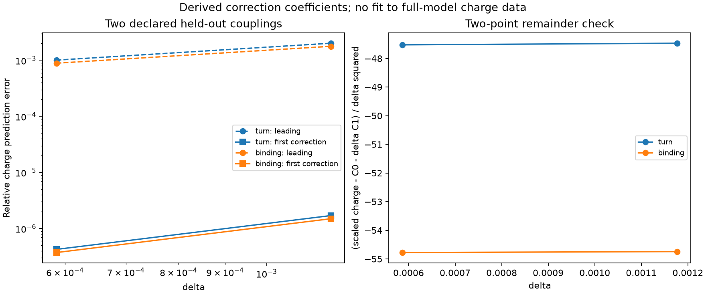

# A first-order stationary reduction near critical coupling in a two-scalar soliton model

**Working manuscript draft — 25 October 2026 — Exploratory / Not Promoted**

**Jason Duran Dutton**  
Independent researcher

This draft is for author and technical review. It is not a submitted manuscript, an approved promotion of exploratory results, or a claim of established novelty.

## Abstract

We study a canonical two-scalar stationary problem with a charged complex field and a second field held in a real, time-independent amplitude sector. A positive-square decomposition and a standard virial identity exclude nontrivial finite-energy stationary profiles in a stated frequency range at and above a critical coupling. Below that coupling, a formal constrained-curve reduction predicts divergent charge scales. We derive its first transverse-amplitude correction and obtain charge coefficients at the stationary charge minimum and the free-particle binding crossing. The coefficients are computed from the reduced equations without fitting full-model charge data. At two subsequently evaluated couplings, the correction reduces charge-prediction errors by factors of approximately 1,200–2,400; the corrected errors range from 0.37 to 1.70 parts per million against numerical full-model solutions. Symbolic expansion, an independent sensitivity equation, finite-delta functional tests and domain/tolerance refinements support the calculation. The expansion remains conditional on smooth-branch assumptions; no uniform singular-limit theorem or nonlinear stability result is established.

## 1. Problem and relation to prior work

Multi-field charged scalar solitons and charge thresholds are established topics [1–3]. Stationary elimination of an uncharged scalar and comparison with the full FLS system provide a close methodological precedent [2]. We investigate a particular self-interacting potential near a degeneracy where the stationary length and charge scales grow.

The question is whether a reduced stationary action, including its induced kinetic metric and first transverse-amplitude correction, quantitatively predicts two distinct full-model charge thresholds. The calculation takes the background geometry and field content as inputs. All quantities below are dimensionless.

The targeted literature comparison accompanying this draft has not established priority or novelty. In particular, neither two branches nor a minimum charge is proposed as a new general phenomenon.

## 2. Model and a stationary obstruction

Use canonical real-component normalization on Minkowski spacetime. With rho=|Phi|^2 and eta=|Sigma|^2,

    L=(|partial Phi|^2+|partial Sigma|^2)/2-V,
    V=rho^2/4+rho/2+2rho eta+(lambda/4)(eta-3/lambda)^2.

The zero-charge vacuum is Phi=0, |Sigma|=sqrt(3/lambda). For the stationary class

    Phi(t,x)=exp(i omega t) f(x),   Sigma(t,x)=s(x),

with real profiles and fixed asymptotic Sigma phase, the charge is Q=omega integral f^2 d^3x. It is the global phase Noether charge; the model has no electromagnetic gauge field. Define m_lambda^2=1+12/lambda and

    S_omega=integral [ (|grad f|^2+|grad s|^2)/2+W_omega ] d^3x,
    W_omega=V-omega^2 f^2/2.

The exact identity

    W_omega=(lambda/4)(s^2-3/lambda+4f^2/lambda)^2
             +(1/4-4/lambda)f^4
             +(m_lambda^2-omega^2)f^2/2

is central.

**Proposition 1, stationary obstruction.** Suppose the profiles are regular finite-energy critical points, the potential contribution is integrable, and dilation generates no surface term. If lambda>=16 and omega^2<=m_lambda^2, the prescribed vacuum is the only such stationary profile.

**Proof.** Write the gradient and potential contributions as K and U. Dilation x->x/a gives S_omega(a)=aK+a^3U, hence K+3U=0 at a critical point. Every term in the displayed decomposition is nonnegative in the stated range. Thus K=0, and the asymptotic condition fixes the constant profiles to the vacuum.

This is an application of the standard Derrick/Pohozaev argument. Its stated class does not include arbitrary time-dependent configurations, time-dependent Sigma charge or different boundary conditions.

For lambda<16, let

    delta=12/lambda-3/sqrt(lambda),
    omega^2=m_lambda^2-delta beta,   0<beta<1,
    z=sqrt(delta) r.

The earlier numerical branch study separates a charge minimum near Q=953.31 from a free-threshold crossing near Q=1225.43 at lambda=12 [4]. Those are background results for the asymptotic investigation here.

## 3. Leading constrained-curve problem

The square in W penalizes departures from s^2=(3-4f^2)/lambda. On a regular branch approaching this curve, introduce

    f=(sqrt(3)/2)sin(theta),
    s0_lambda=sqrt(3/lambda)cos(theta).

At lambda=16 the induced kinetic coefficient is

    a(theta)=(3/16)(1+3cos^2(theta)).

The candidate leading scaled action is

    A0=integral [ a(theta)|grad_z theta|^2/2
                  +beta rho/2-(2/3)rho^2 ] d^3z,
    rho=(3/4)sin^2(theta).

We solve its radial Euler equation with a regular origin and decaying tail. The limiting turn and binding points occur at beta approximately 0.12437038 and 0.26513103, with scaled charges 38.53902853 and 50.59921950.

This reduction assumes a regular branch in a chart where cos(theta)>0. Convergence to the curve and uniform control of possible endpoint or layer effects have not been proved.

## 4. First transverse-amplitude correction

Set s=s0_lambda+delta chi. Expanding A_delta=delta^(1/2)S_omega gives the local first-order terms

    (1/4)sin^2(theta)|grad theta|^2
       +(4/9)rho^2+grad s00 . grad chi+3cos^2(theta)chi^2,

where s00=(sqrt(3)/4)cos(theta). Integration by parts and stationary elimination yield

    chi0=Delta s00/[6cos^2(theta)],

and

    A1=integral [
         (1/4)sin^2(theta)|grad theta|^2
         +(4/9)rho^2
         -(Delta s00)^2/[12cos^2(theta)] ] d^3z.

The first two contributions arise from the changing curve metric and restricted potential. The third is the transverse response. The identity is checked by exact symbolic expansion and completion of the square.

The correction is evaluated perturbatively on leading stationary profiles. Its higher derivatives are not treated as a new fundamental fourth-order theory. Sigma phase dynamics is not eliminated by this static amplitude calculation.

For prescribed f, one elimination step also admits an explicit conditional error estimate. With s0^2=(3-4f^2)/lambda and chi_lambda=Delta s0/(2lambda s0^2), the approximation s_app=s0+delta chi_lambda has exact residual

    R=delta^2[-Delta chi_lambda+3lambda s0 chi_lambda^2]
        +delta^3 lambda chi_lambda^3.

If c^2=1-4f^2/3 is bounded below by c_*^2>0 and both the exact amplitude and s_app remain at least 3s0/4, their error satisfies a scalar elliptic equation with coefficient at least mu=(33/16)c_*^2. The maximum principle bounds the interior sup-norm error by the larger of the boundary error and ||R||_infinity/mu. Uniform residual and boundary bounds therefore give a conditional O(delta^2) amplitude estimate. The proof and hypotheses are recorded in AMPLITUDE_BOUND.md; they do not establish the required coupled-branch bounds.

## 5. Conditional charge formulas

Assume the on-shell action has a sufficiently differentiable, locally uniform expansion A_delta=A0+delta A1+O(delta^2). Stationarity supplies

    Q delta^(3/2)=2omega partial_beta A_delta.

With m_c=sqrt(7)/2, I0=2A0'(beta), and Q0=m_c I0,

    Q delta^(3/2)=Q0+delta Q1+O(delta^2),
    Q1=2m_c A1'(beta)+(2-beta)I0/(2m_c).

At a nondegenerate minimum beta_t of Q0, displacement of the minimizer contributes only at second order to its charge value. Therefore C1_turn=Q1(beta_t).

At a simple binding root beta_b, the exact condition is A_delta=beta[Q delta^(3/2)]/(m_lambda+omega). Including displacement of that root gives

    C1_binding=(2m_c/beta_b)A1(beta_b)
                 +Q0(beta_b)(4-beta_b)/(4m_c^2).

Consequently the formal predictions are

    Q_turn delta^(3/2)=38.53902853+66.25169133 delta+O(delta^2),
    Q_binding delta^(3/2)=50.59921950+76.66926995 delta+O(delta^2).

The conditional smoothness and nondegeneracy assumptions are essential. The numerical record does not establish a uniform continuum remainder bound.

## 6. Numerical method and prediction protocol

Both reduced and full equations are solved by radial collocation with the origin's singular term treated explicitly. We use x=sqrt(beta delta)r for the full problem and x=sqrt(beta)z for the reduced problem. Thus physical domain size grows with the tail scale.

The correction coefficients use reduced profiles only. Five-point differentiation at four step sizes is checked against an independent linear boundary-value problem for partial_beta theta. The latter reproduces C1_turn within approximately 6.2e-11. Direct finite-delta action evaluations provide a separate expansion check.

The coefficient file and source hashes were recorded before evaluating the two new full-model couplings, lambda=15.95 and 15.975. No parameter in the coefficient formulas was fitted to those charges. This was an adaptive in-session design, not an externally preregistered or independently blinded study.

A bounded scalar minimization locates the full-model charge minimum; a bracketed root solve locates E/Q=m_lambda. Only converged, nontrivial, nodeless profiles passing the tail check are accepted.

## 7. Results

| lambda | Quantity | Leading relative error | Corrected relative error |
|---|---|---:|---:|
| 15.95 | Charge minimum | 0.20167% | 1.7013 ppm |
| 15.975 | Charge minimum | 0.10078% | 0.4246 ppm |
| 15.95 | Binding charge | 0.17780% | 1.4948 ppm |
| 15.975 | Binding charge | 0.08884% | 0.3728 ppm |

Errors are against computed stationary full-model charges. One ppm denotes relative error 1e-6.

The corrected scaled-charge remainder divided by delta squared is approximately -47.47 and -47.52 at the two turn points, and -54.74 and -54.78 at binding. This two-point behavior is consistent with the next order, while falling short of a proof.

At fixed beta, increasing the scaled domain from X=40 to 48 and tightening collocation tolerance from 1e-9 to 1e-10 changes the scaled charges by at most approximately 3.1e-12 relatively. These changes are substantially below the correction errors; they are not certified total error bounds or a reoptimization of the extrema.

## 8. Discussion and limitations

The first correction predicts substantially more than the leading charge divergence at the selected new couplings. Its on-shell construction avoids computing the unknown first angular-profile correction directly. Independent action, sensitivity and full-model checks support the calculation.

A rigorous singular-limit result would require a specified function space, control of the transverse chart, decay estimates, an invertible radial linearization and a uniform remainder estimate. Global existence, uniqueness, global energetic optimality, nonlinear stability and observational interpretation remain unresolved.

The stationary amplitude sector can be written as a self-interacting FLS-type problem after normalization. The complex Sigma field's additional phase is held fixed and does not itself establish novelty. A broader comparison with self-interacting FLS models and stationary derivative expansions is required before asserting an original contribution.

## Data, code and assistance

Source, frozen predictions, all recorded full-model evaluations, final profiles, checksums and reproduction commands accompany this draft. The preceding branch calculations remain versioned at the linked public checkpoint [4]. Substantive AI assistance was used for derivation, code, analysis and drafting. Author verification and independent technical review are pending.

## References

1. O. Lennon, [Multi-Field Q-balls with Real Scalars](https://arxiv.org/abs/2112.14263) (2021).
2. E. Kim and E. Nugaev, [Effectively flat potential in the Friedberg–Lee–Sirlin model](https://doi.org/10.1140/epjc/s10052-024-13167-w), European Physical Journal C 84, 797 (2024).
3. J. Heeck and M. Sokhashvili, [Revisiting the Friedberg–Lee–Sirlin soliton model](https://doi.org/10.1140/epjc/s10052-023-11710-9), European Physical Journal C 83, 526 (2023).
4. J. D. Dutton, [Frequency continuation, charge turn and near-critical coupling](https://github.com/JasonSEFIDEFI/SEFI-PY/tree/446e6177ec30b840a0fcd336ff72dd96a1c2df4e/research/2026-10-25/localized-frequency), exploratory computational record (2026).

