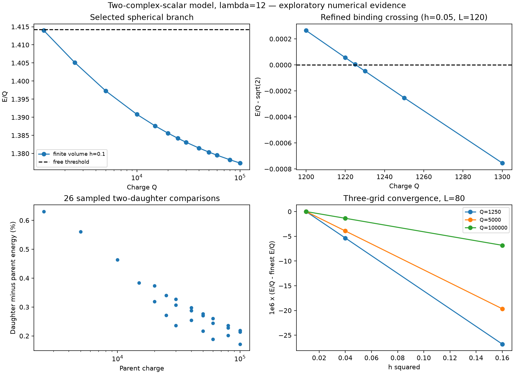

# Localized vacuum branch: continuation toward a bounded paper

25 October 2026. **Exploratory numerical research / Not Promoted.** No journal submission or author approval to promote is recorded here.

This study extends the existing lambda=12 spherical fixed-charge branch in the two-complex-scalar model. It reproduces the reference energy, continues charge, tests selected fragmentation partitions, and checks results with a separately implemented continuum collocation solver. It does not derive spacetime, observed particles or SEFI identity coordinates.

## Main findings

- Thirteen charges from 1250 to 100000 converge at each of h=0.4, 0.2 and 0.1, with L=80. The reference E/Q at Q=100000 is 1.3773678983683 on h=0.1, reproducing the archived result.
- All thirteen selected profiles lie below sqrt(2), the free-Phi threshold. Grid differences follow approximately second-order convergence; see summary.json for measured ratios.
- All 26 sampled positive-charge two-daughter comparisons on the selected branch have E(Q1)+E(Q2)>E(Q). This is a comparison of computed spherical candidates, not a bound over all possible configurations.
- Targeted continuation shows a binding crossing near Q=1225.43. Continuum collocation at L=120 gives Q=1225.425284 to solver accuracy. This number is not an interval-certified continuum threshold, minimum existence charge, or universal physical constant.
- Q=1225 appears below threshold at h=0.2 but above it at h=0.1 and 0.05. This sign reversal is retained as a warning against relying on small residuals alone.
- Localized stationary profiles at Q=1200,1100,1000 have E/Q>sqrt(2). Being stationary is distinct from being below the free-field threshold.
- At h=0.2,L=100 the Q=900 and 800 attempts did not converge; Q=600 converged to an extended box-filling state (RMS radius about 52.5, omega above sqrt(2), about 4.5% of charge in r>0.8L). These are not evidence of localized vacuum objects or proof of nonexistence.
- Independent collocation checks at five charges converge, with charge errors below 2e-10 and virial residuals below 1e-10. Finite-volume discrepancies are reported, not hidden.
- Centered numerical derivatives of the collocation energy agree with dE/dQ=omega at Q=1250,5000,100000. At relative step 0.0005, absolute errors are below 2e-9.
- Selected fixed-charge energy-Hessian calculations at Q=1250,1200,1000, in angular sectors l=0,1,2, find no negative direction beyond phase-zero roundoff (smallest about -4.6e-14). They are finite-grid energy curvatures, not dynamical frequencies or a general nonlinear stability theorem.
- At the collocation crossing charge, increasing the domain from L=100 to L=120 changes E/Q by less than 1e-14 in these runs; see threshold_domain_check.json. This does not certify an infinite-domain error bound.

See [analytic structure](ANALYTIC_STRUCTURE.md), [publication assessment](PUBLICATION_READINESS.md), [branch table](branch_table.csv), [fragmentation comparisons](fragmentation_table.csv), and [summary](summary.json).

## Model and scope

Canonical real-component kinetic normalization is one half per complex modulus squared, on assumed flat spacetime. With rho=|Phi|^2 and eta=|Sigma|^2:

    V = rho^2/4 + rho/2 + 2 rho eta + lambda(eta-3/lambda)^2/4.

The vacuum is Phi=0, |Sigma|=sqrt(3/lambda). Set Phi=exp(i omega t) f(r), Sigma=s(r), Q_Sigma=0. At fixed Q=omega I, I=4 pi integral r^2 f^2 dr:

    E_Q = 4 pi integral r^2 [(f'^2+s'^2)/2+V] dr + Q^2/(2I).

The inherited finite-volume model uses cell-centered shells, regular origin and fixed outer vacuum data. The new driver adds configurable Q/lambda, radius-scaled continuation seeds and sparse Newton polishing with the exact fixed-charge rank-one Hessian term. Relaxation finds candidates; Newton polishing reduces their residuals. Convergence alone does not establish minimization.

The collocation implementation solves the continuum radial ODEs with omega as an unknown and an integral-charge state, treating the origin's 2/r terms through solve_bvp's singular matrix. It shares the mathematical model and finite-volume seed but not the finite-volume discretization or nonlinear solver. It is numerical cross-validation, not independent human review.

## Reproduction

Python 3.14.7; pinned packages in requirements.txt. Commands below must use new output directories because existing runs are protected.

    python -m pip install -r requirements.txt
    python continue_branch.py --h 0.4 --L 80 --out h0p4_L80
    python continue_branch.py --h 0.2 --L 80 --out h0p2_L80
    python continue_branch.py --h 0.1 --L 80 --out h0p1_L80
    python continue_branch.py --h 0.2 --L 100 --charges 2500,1500,1300,1250,1225,1200,1150,1100,1000,900,800,600 --out threshold_h0p2_L100
    python continue_branch.py --h 0.1 --L 100 --charges 2500,1500,1300,1250,1230,1225,1220,1200,1100,1000 --out threshold_h0p1_L100
    python continue_branch.py --h 0.05 --L 120 --charges 2500,1300,1250,1230,1225,1220,1200 --out threshold_h0p05_L120
    python independent_bvp.py
    python additional_checks.py
    python -c "from independent_bvp import validate; import json; r=validate('threshold_h0p1_L100',1225.4252840308072,tol=1e-9,seed_Q=1225); open('threshold_domain_check.json','w').write(json.dumps(r,indent=2)+'\n')"
    python summarize.py

Run these commands in an empty copy of the source files, or retain the provided results and choose new directory names with corresponding script adjustments. Eigenvalue checks can take several minutes. No live simulations or automated recurring jobs remain after this run.

Finite-volume energy-gradient directional checks run before each scan. The Hessian directional check is recorded in additional_checks.json. Iteration failures and profiles are retained alongside successes. CSVs are the convenient review tables; JSONs contain run configurations and diagnostics; NPZ files contain numerical profiles.

## Provenance

Inherited vacuum_spherical.py and spherical_stability.py are copied unchanged from public SEFI-PY commit 847a071351ed2b1c54e240fd9a520a1cce238178, research/2026-10-19/vortex-extended. Original documentation remains untouched. Existing physical derivations and negative results are preserved.

New calculations and code were developed with substantive AI assistance; they require author review and independent scientific checking before submission. The threshold scan was exploratory and adaptively refined, not preregistered. manifest.json records file checksums; source hashes at scan execution are also in each results.json.

The [SEFI-INV-001 gate](https://github.com/JasonSEFIDEFI/Research/blob/main/research/checkpoints/SEFI-INV-001.md) remains Exploratory / Not Promoted. This numerical branch study does not constitute inverse reconstruction or approval to promote any result.

