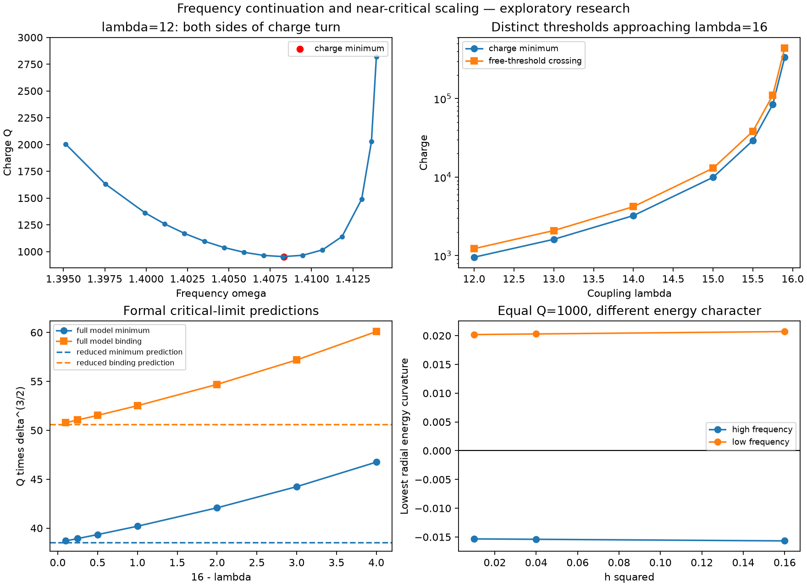

# Frequency continuation, charge turn and near-critical coupling

25 October 2026. **Exploratory / Not Promoted.** Model-dependent classical calculations. No journal submission, physical-particle identification or established novelty claim.

This follows the [fixed-charge continuation study](https://github.com/JasonSEFIDEFI/SEFI-PY/tree/d3fa758cb9404ddcfd58d6f2e5bb6c46a6dead19/research/2026-10-25/localized-branch). The earlier binding crossing was not a minimum existence charge. Frequency continuation now resolves a separate numerical charge turn, a pair of equal-charge stationary profiles with different constrained-energy character, and a near-critical scaling prediction.

## Main findings

At lambda=12:

- The selected positive nodeless spherical branch has a numerical charge minimum near **Q=953.312875**, omega=1.408323442, beta=0.124091312.
- The previous free-threshold binding crossing remains near **Q=1225.4253**, beta=0.26629561. The two thresholds are distinct.
- At Q=1000, two stationary profiles exist numerically: the high-frequency state has omega=1.410385979 and E=1416.806504; the low-frequency state has omega=1.405713915 and E=1416.660453.
- The high-frequency state's lowest computed radial fixed-charge amplitude curvature remains negative under h=0.4,0.2,0.1 and an L=120 to 160 domain check (about -0.01533 at h=0.1). It is therefore a computed constrained-energy saddle, not a local constrained-energy minimum.
- The compared low-frequency state's three lowest radial amplitude curvatures are positive in those checks (lowest about +0.02019 at h=0.1). This is a finite-grid local energetic check, not a proof of nonlinear dynamical stability.
- The frequency branch continues to smaller beta with rising charge as omega approaches the vacuum mass. This explains why fixed-Q relaxation alone could miss the second branch. No claim that every possible solution has been found is made.

The lambda=12 minimum changes by about 6e-7 in Q between the X=32,tol=1e-7 scan and X=40,tol=1e-9 verification. These differences are numerical consistency evidence, not rigorous error bounds.

## Approaching lambda=16

The computed charge minimum grows rapidly:

| lambda | Numerical Q minimum | Free-threshold crossing Q |
|---|---:|---:|
| 12 | 953.31 | 1225.43 |
| 13 | 1610.83 | 2082.51 |
| 14 | 3230.35 | 4198.93 |
| 15 | 9926.88 | 12969.75 |
| 15.5 | 29219.92 | 38271.23 |
| 15.75 | 84280.08 | 110521.36 |
| 15.9 | 337043.78 | 442304.54 |

Define delta = 12/lambda - 3/sqrt(lambda). A formal constrained-curve limit derived in [CRITICAL_LIMIT.md](CRITICAL_LIMIT.md) predicts

    Q_turn ~ 38.53903 delta^(-3/2),
    Q_binding ~ 50.59922 delta^(-3/2).

The full-model scaled minimum at lambda=15.9 is about 38.69526, roughly 0.41% above the limiting prediction. The prediction is derived from a reduced variational problem, not just fitted to the full-model charges. The singular limit and its error estimates are not proved.

A separate virial argument excludes nontrivial finite-energy stationary profiles in the stated harmonic-Phi/static-Sigma ansatz for lambda>=16 and omega^2<=m_Phi^2, under the regularity, integrability and boundary assumptions in [CRITICAL_LIMIT.md](CRITICAL_LIMIT.md). This is a specific application of the standard Derrick/Pohozaev argument, not a claim excluding all time-dependent structures.

## Numerical formulation

Use beta=(m_Phi^2-omega^2)/delta in (0,1), kappa=sqrt(beta delta), x=kappa r. The solver evolves f,f_x,s,s_x in x and treats -2/x radial terms through solve_bvp's singular matrix. Physical domain L=X/kappa therefore grows as tails become longer, instead of holding a potentially misleading physical box fixed.

Seeds come from the previous Q=1250 profile at public commit d3fa758cb9404ddcfd58d6f2e5bb6c46a6dead19. Solutions must converge, remain nontrivial and nodeless with positive f(0), and pass a tail-charge check. Small residual alone does not distinguish the trivial vacuum from a localized branch.

Initial large frequency steps near lambda=16 sometimes converged to the trivial vacuum or exhausted mesh nodes. These are rejected and retained. Smaller steps recovered the branch. They are not classified as physical nonexistence.

## Reproduction and artifacts

Python 3.14.7 and pinned dependencies in requirements.txt. Start with a fresh copy of source files plus seed_Q1250.npz; existing run directories/files are protected. The reference/ directory makes the Hessian check self-contained.

    python -m pip install -r requirements.txt
    python frequency_scan_initial.py --out scan_X32
    python recover_critical.py
    python verify_turn.py
    python paired_hessian.py
    python critical_limit.py
    python validate_limit.py
    python summarize_frequency.py

The first scan records failures and continues by its declared rules. The recovery and verification scripts use the corrected seed strategy. Preserved initial verification/limit outputs document earlier interrupted attempts; they are not substituted for the completed refined records.

- scan_X32/results.json: original frequency attempts, rejections and charge minimizations.
- critical_recovery/results.json: smaller-step recovery near the critical coupling.
- verification_refined/results.json: tighter lambda=12 minimum, equal-charge pair, and coupling binding crossings.
- paired_hessian_refined.json: completed grid/domain comparison for both Q=1000 profiles.
- critical_limit_refined.json: reduced-model predictions.
- critical_limit_validation.json: X=48,tol=1e-10 check; scaled charges change by less than 1.3e-10 from X=40,tol=1e-9.
- coupling_table.csv and frequency_table.csv: review tables.
- NPZ profiles: raw full-model fields and derivatives in x.
- summary.json and manifest.json: derived summaries and checksums.
- [PUBLICATION_READINESS.md](PUBLICATION_READINESS.md): bounded paper scope and remaining work.

Frequency minimization is over a declared interval on this selected branch; it is not an existence theorem or a certified global minimum over all field configurations. No independent human review, nonlinear three-dimensional evolution, calibrated observational test or SEFI identity-coordinate derivation is supplied.

All work here uses public model material. Substantive AI assistance was used in derivation, code, analysis and documentation; scientific responsibility and final approval remain with the author.

